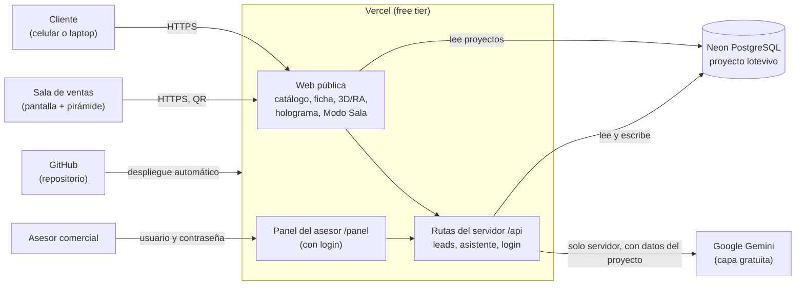
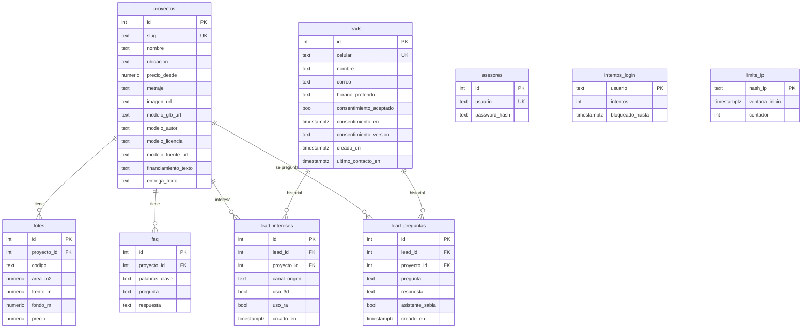

# Technical Design Document: LoteVista

**Tipo de proyecto:** Greenfield (la carpeta solo contenía `PRD.md`, `CLAUDE.md` y configuración de skills).
**Design.md disponible:** No — el modelo de datos se derivó solo del PRD.

## Resumen

LoteVista es un visor inmobiliario web en 3D y Realidad Aumentada, con asistente IA y modo holograma, para una inmobiliaria que vende lotes. Este documento define cómo construir el MVP descrito en [`PRD.md`](PRD.md) antes del lunes 26 de octubre de 2026, con las restricciones del curso: Vercel (free tier), PostgreSQL en Neon y repositorio en GitHub. La prioridad es la simplicidad: una sola aplicación, pocas dependencias, secretos solo en variables de entorno y datos personales guardados únicamente con consentimiento. Las decisiones se rigen por el orden de prioridad del PRD (núcleo → RA → QR → asistente → holograma → Modo Sala) y por las reglas de TDD del `CLAUDE.md`.

## Arquitectura de componentes

Una sola aplicación Next.js (ADR 0001) con cuatro zonas:

- **Web pública:** catálogo, ficha del proyecto con visor 3D/RA (`<model-viewer>`), formulario de lead, ventana del asistente, página de holograma y Modo Sala. Las páginas de lectura consultan la base de datos en el servidor.
- **Panel del asesor (`/panel`):** protegido por login; lista leads por proyecto con su historial.
- **Rutas del servidor (`/api`):** crear/actualizar leads, preguntar al asistente, login del panel y consulta de leads (ADR 0003).
- **Datos:** Neon PostgreSQL, con una rama aparte para pruebas.

El navegador **nunca** habla directamente con Neon ni con Gemini: los secretos (`DATABASE_URL`, `GEMINI_API_KEY`, `AUTH_SECRET`, `IP_HASH_SECRET`) viven solo en `.env.local` y en las variables de entorno de Vercel.

## Decisiones de arquitectura

| # | Decisión | Estado |
|---|---|---|
| [ADR-0001](adrs/0001-una-sola-aplicacion-nextjs.md) | Una sola aplicación Next.js para todo el sistema | Aceptado |
| [ADR-0002](adrs/0002-stack-tecnologico.md) | Stack tecnológico | Aceptado |
| [ADR-0003](adrs/0003-contratos-de-api.md) | Contratos de API con rutas JSON del servidor | Aceptado |
| [ADR-0004](adrs/0004-autenticacion-del-panel.md) | Autenticación del panel del asesor | Aceptado |
| [ADR-0005](adrs/0005-asistente-ia-y-resiliencia.md) | Asistente IA acotado a los datos y resiliencia ante fallas | Aceptado |
| [ADR-0006](adrs/0006-manejo-de-estado.md) | Manejo de estado: la actividad previa al lead vive en el navegador | Aceptado |
| [ADR-0007](adrs/0007-modelo-de-datos.md) | Modelo de datos | Aceptado |

Decididas por el Product Owner: ADR-0001 (opción A) y ADR-0006 (opción B, más los refuerzos de límite por IP y aviso en el chat en ADR-0005). El resto se aplicó por delegación, con la opción más simple y segura.

## Modelo de datos

Entidades principales (detalle en ADR-0007):

Notas:

- `asesores`, `intentos_login` y `limite_ip` no tienen relaciones: el panel consulta leads sin ligarlos a un asesor, `intentos_login` lleva el conteo de fallos por usuario y `limite_ip` es temporal (se borra a las 24 horas).
- `canal_origen` solo admite `web`, `qr_sala` o `holograma`.
- No existe campo de DNI.

## Criterios de aceptación por flujo

### Catálogo y ficha del proyecto

- [ ] El catálogo muestra los 3 proyectos con nombre, ubicación, precio desde, metraje e imagen, leídos de la base de datos.
- [ ] Al abrir un proyecto inexistente se muestra una página amable con enlace al catálogo (sin error técnico).
- [ ] La ficha muestra los datos del lote, el financiamiento como texto y la etiqueta "Imagen referencial" junto a la casa.
- [ ] Los créditos del modelo 3D (autor, licencia, fuente) aparecen en el README.

### Visor 3D y Realidad Aumentada

- [ ] El modelo 3D se puede girar y acercar con mouse o dedo.
- [ ] La etiqueta "Imagen referencial" es visible sobre la casa en el 3D, en la RA y en cualquier pantalla donde se muestre.
- [ ] En un celular compatible con ARCore/ARKit, "Ver en tu espacio" abre la RA; en laptop o equipo sin RA se mantiene el 3D y se muestra un aviso claro.
- [ ] Si el modelo no carga, se muestra la imagen del proyecto con la etiqueta "Imagen referencial" visible.
- [ ] El navegador registra en memoria si se usó el 3D o la RA, sin enviar nada al servidor antes del formulario.

### Formulario de interés (lead)

- [ ] El lead exige nombre, celular peruano válido (9 dígitos) y correo válido; sin consentimiento aceptado no se guarda (el servidor responde error, 0 excepciones).
- [ ] El horario preferido es opcional.
- [ ] Un lead nuevo guarda además el proyecto, el canal de origen, el uso de 3D/RA, las preguntas del chat y las fechas.
- [ ] Un segundo envío con el mismo celular no crea un lead nuevo: agrega el proyecto y las preguntas al historial y actualiza la fecha del último contacto, sin borrar nada.
- [ ] Un doble clic o dos envíos del mismo lead y proyecto en menos de 10 minutos no generan duplicados.
- [ ] No existe en el formulario ni en la base de datos ningún campo de DNI.

### Asistente IA

- [ ] Muestra siempre el aviso "No compartas datos personales en el chat. Si deseas que te contactemos, usa el formulario."
- [ ] Responde solo con datos del proyecto guardados en la base de datos: en 10 preguntas de prueba, al menos 8 respuestas son correctas.
- [ ] En 5 preguntas fuera de los datos (o que piden negociar precios, descuentos o citas), deriva a un asesor las 5 veces y no inventa.
- [ ] Con Gemini caído, agotado o que tarda más de 8 segundos, responde el respaldo de FAQ; si no hay coincidencia, deriva a un asesor; el cliente nunca ve un error técnico.
- [ ] Tras 20 preguntas en una sesión, el asistente indica que se alcanzó el límite y sugiere el formulario.
- [ ] El servidor no guarda el contenido de las preguntas; solo guarda un contador por IP con hash que se borra pasadas 24 horas.
- [ ] La clave de Gemini no aparece en el navegador ni en el repositorio.

### QR por proyecto

- [ ] Cada proyecto genera un QR que abre su ficha en el celular con el canal de origen correcto.
- [ ] Un QR de un proyecto inexistente lleva a la página amable de error.

### Panel del asesor

- [ ] Sin sesión, `/panel` redirige al login y `/api/panel/leads` responde 401.
- [ ] Credenciales erróneas muestran un mensaje único ("Usuario o contraseña incorrectos") sin indicar cuál falló.
- [ ] Tras 5 intentos fallidos seguidos de un mismo usuario, el login se bloquea 15 minutos (incluso con la contraseña correcta); pasado ese tiempo vuelve a funcionar, y un login correcto reinicia el contador.
- [ ] Con sesión, se listan los leads por proyecto, con nombre, celular, correo, horario, canal, uso de 3D/RA, fechas, historial de proyectos y preguntas al asistente.
- [ ] Sin leads, se muestra un estado vacío.
- [ ] Las preguntas se muestran como texto (nunca como HTML ejecutable).
- [ ] Las contraseñas están guardadas como hash en la base de datos.

### Modo holograma (diferenciador 4)

- [ ] Muestra pantalla negra con el modelo 3D 4 veces (arriba, abajo, izquierda, derecha) girando, con la etiqueta "Imagen referencial" en las 4 vistas.
- [ ] Un lead que entra desde esta página queda con canal `holograma`.

### Modo Sala (opcional)

- [ ] Muestra el modelo 3D girando en pantalla completa y un QR hacia la ficha, con la etiqueta "Imagen referencial".

### Despliegue y seguridad

- [ ] La aplicación está desplegada en Vercel y conectada a Neon.
- [ ] Ningún secreto está en el repositorio; `.env.local` está en `.gitignore`.
- [ ] La ficha del proyecto carga en menos de 3 segundos con 4G (percentil 95).

## Riesgos técnicos abiertos

- **Neon se duerme por inactividad:** la primera consulta puede tardar; abrir la app antes de la demo.
- **Tiempo máximo de las funciones en Vercel (free tier):** el límite de 8 segundos para Gemini debe verificarse contra el tiempo máximo real de las funciones antes de la demo.
- **Valores aceptados por el Product Owner, sin validar con datos reales:** 20 preguntas por sesión, 500 por IP y por 24 horas (subido de 150 por las IP compartidas en sala y ferias), ventana de 10 minutos para fusionar envíos duplicados y 8 segundos de espera a Gemini.
- **IP compartida en sala de ventas o ferias:** el límite por IP se subió a 500 por esto; a cambio protege menos la cuota de Gemini.
- **El hash de IP sigue siendo un dato derivado:** se guarda 24 horas y sin contenido, pero en producción real habría que reflejarlo en la política de privacidad y revisar la Ley 29733 (retención, borrado, registro del banco de datos).
- **Login:** el bloqueo de 15 minutos tras 5 fallos frena adivinar contraseñas, pero permite bloquear a propósito a un asesor real; no hay recuperación de contraseña (se cambia con el script).
- **Mismo celular, distinta persona:** un celular ajeno o mal escrito se fusiona con otro lead.
- **Preguntas llegan desde el navegador:** el servidor no puede comprobar que realmente se hicieron; se limita su tamaño y se muestran escapadas.
- **RA en iPhone y Android:** depende de HTTPS (Vercel lo da) y de un celular compatible prestado para validar y grabar el video.
- **Cambios en la API de Gemini o en su cuota gratuita:** se mitiga con el FAQ de respaldo y con `GEMINI_MODEL` configurable.
- **Modelos 3D pesados con datos móviles:** conviene elegir modelos livianos y comprimidos; pendiente encontrar modelos CC0/CC-BY adecuados.
- **Sin migraciones automáticas:** los cambios de estructura se aplican a mano con SQL.
