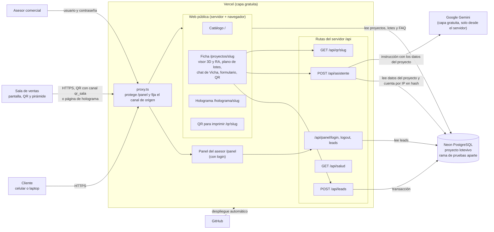
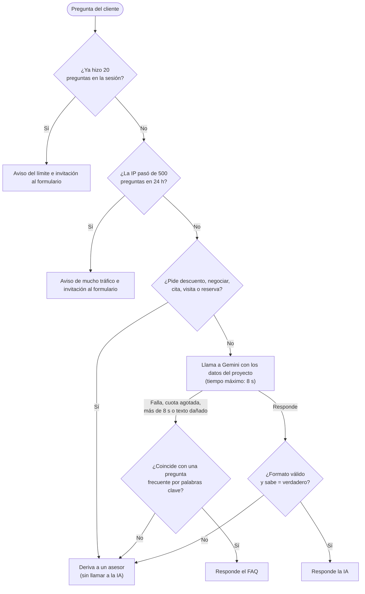
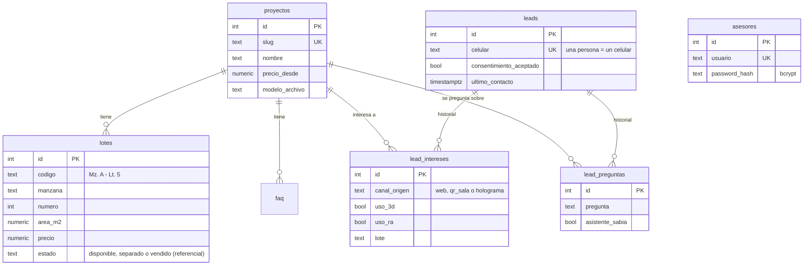

# Arquitectura de LoteVista

> Todos los datos del proyecto son ficticios. Este documento resume cómo está construida la aplicación; las decisiones y sus motivos están en `adrs/` y `TECH-DESIGN.md`.

LoteVista es **una sola aplicación Next.js** (ADR 0001) desplegada en Vercel, con una base de datos PostgreSQL en Neon y Google Gemini como asistente de IA. Los secretos viven solo en variables de entorno y el navegador **nunca** habla directamente con Neon ni con Gemini.

## 1. Arquitectura



**Qué vive en cada lugar**

| Dato | Dónde | Por qué |
|---|---|---|
| Proyectos, lotes, FAQ, asesores, leads y su historial | Neon (servidor) | Única fuente de verdad (ADR 0006) |
| Uso de 3D/RA y preguntas del chat **antes** del formulario | Solo el navegador (`sessionStorage`) | No se guarda nada personal antes del consentimiento (Ley 29733) |
| Canal de origen (`web`, `qr_sala`, `holograma`) | Cookie firmada `lv_canal` | Viene del QR o de la página de holograma |
| Contador de preguntas de la sesión | Cookie firmada `lv_asistente` | Límite de 20 por sesión |
| Contador por IP (24 h) | Tabla `limite_ip`, solo el **hash** de la IP | Límite de 500; no se guarda la IP real |
| Sesión del asesor | Cookie `lv_sesion`, `httpOnly`, 8 horas | Panel protegido |

## 2. Flujo del lead (de la visita al panel)

```mermaid
sequenceDiagram
    autonumber
    actor C as Cliente
    participant N as Navegador
    participant P as proxy.ts
    participant S as Servidor Next.js
    participant G as Gemini
    participant DB as Neon
    actor A as Asesor

    C->>P: Abre la ficha (por la web o por el QR ?canal=qr_sala)
    P-->>N: Fija la cookie firmada del canal (valor inválido = web)
    N->>S: Pide la página
    S->>DB: Lee proyecto, lotes y FAQ
    DB-->>S: Datos
    S-->>N: Ficha con visor 3D, plano de lotes, chat y formulario

    Note over N: Mover la casa en 3D o abrir la RA se anota solo en sessionStorage (sin enviar nada)

    C->>N: Pregunta a Vicha
    N->>S: POST /api/asistente (proyecto y pregunta)
    S->>S: Límite de sesión (cookie) y de IP (hash)
    alt Pide descuento, cita o reserva
        S-->>N: Deriva a un asesor (sin llamar a la IA)
    else Pregunta normal
        S->>G: Instrucción solo con los datos del proyecto (máximo 8 s)
        alt Gemini responde bien
            G-->>S: respuesta y sabe
            S-->>N: Respuesta (o derivación si no sabe)
        else Falla, sin cuota o tarda más de 8 s
            S-->>N: Respuesta del FAQ por palabras clave (o derivación)
        end
    end
    N->>N: Guarda la pregunta y la respuesta en sessionStorage

    C->>N: Elige un lote en el plano y toca "Quiero información"
    C->>N: Llena el formulario y acepta el tratamiento de datos
    N->>S: POST /api/leads (datos, lote, uso de 3D/RA y preguntas del chat)
    S->>S: Valida con Zod (sin consentimiento = no se guarda; sin campos de más)
    S->>DB: Transacción: crea o actualiza el lead por celular,<br/>suma o fusiona el interés (10 min) y agrega las preguntas
    DB-->>S: Listo
    S-->>N: Gracias (misma respuesta si el celular ya existía)

    A->>P: Entra a /panel
    P-->>A: Sin sesión: redirige al login (5 fallos = bloqueo de 15 minutos)
    A->>S: Usuario y contraseña (hash bcrypt)
    S-->>A: Cookie de sesión de 8 horas
    A->>S: Abre el panel
    S->>DB: Lee leads con su historial, canal, uso de 3D/RA, lote y preguntas
    S-->>A: Lista filtrable por proyecto, con todo el texto escapado
```

## 3. Cómo decide el asistente



Reglas que no cambian: el asistente **solo** usa los datos guardados del proyecto, no inventa, no negocia, no agenda, y el cliente **nunca** ve un error técnico.

## 4. Modelo de datos (resumen)



Tablas sin relaciones: `asesores`, `intentos_login` (bloqueo del login) y `limite_ip` (contador temporal por hash de IP, se borra a las 24 horas). No existe ningún campo de DNI.

## 5. Variables de entorno

| Variable | Uso |
|---|---|
| `DATABASE_URL` | Base de datos de la demo (producción) |
| `DATABASE_URL_TEST` | Rama de pruebas de Neon: **solo** para pruebas y trabajo local |
| `AUTH_SECRET` | Firma de la sesión del asesor |
| `COOKIE_SECRET` | Firma de las cookies del visitante (canal y contador de preguntas) |
| `IP_HASH_SECRET` | Convierte la IP en hash para el límite del asistente |
| `GEMINI_API_KEY` | Clave de Gemini (solo se lee en `/api/asistente`) |
| `GEMINI_MODEL` | Opcional; por defecto `gemini-3.5-flash-lite` |
| `SITE_URL` | Opcional; dirección pública que usan los QR |
| `ASESOR_n_USUARIO` / `ASESOR_n_CLAVE` | Solo para el script que crea los asesores |
